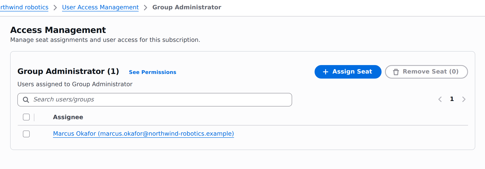

.. _admin-group-administrators:

Group Administrators
====================

A **Group Administrator** can create groups and manage who belongs to them,
without having full Organization Admin rights. The **Group Administrator**
page lists everyone who holds this seat.

Open :doc:`Organisation Administration <index>` and click on **Group
Administrator** in the menu on the left, under **User Access Management**:

* To make someone a Group Administrator, click on **Assign Seat** and follow
  the steps in :doc:`users`.

* To remove the seat from someone, tick the box next to their name and
  click on **Remove Seat**, as described in :doc:`org-administrators`.
