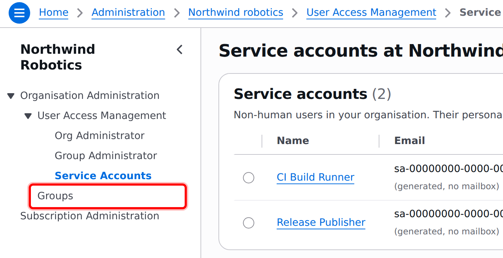
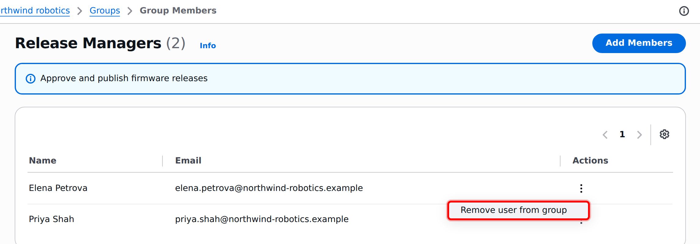

.. _admin-groups:

Groups
======

Groups let you give the same access to several people at once. When you
assign a seat to a group, everyone in the group gets it, and people who
join the group later get it too.

You need an **Organization Admin** or **Group Administrator** seat to manage
groups. Open :doc:`Organisation Administration <index>` and click on
**Groups** in the menu on the left:

The list shows each group's description, type and number of members.

Creating a group
----------------

1. Click on **Create Group**:

   .. image:: org-groups-2.png
       :scale: 50 %
       :alt: Groups list with the Create Group button highlighted

2. Fill in the form, then click on **Create**:

   .. image:: org-groups-3.png
       :scale: 50 %
       :alt: Create Group form with the Create button highlighted

   * **Group Type**: choose **Normal Group** for a group whose members you
     choose. An **Org-Sync Group** always contains everyone in your
     organisation, and is named after it automatically.

   * **Group Name**: must be different from the names of your other
     groups.

   * **Description** (optional): what the group is for.

   * **Public Visibility**: tick this to make the group visible outside
     your organisation. Leave it unticked unless you need it.

Adding people to a group
------------------------

1. Click on the three-dot menu at the end of the group's row, then click on
   **View Members**:

   .. image:: org-groups-4.png
       :scale: 50 %
       :alt: Group actions menu with View Members highlighted

2. Click on **Add Members**:

   .. image:: org-groups-5.png
       :scale: 50 %
       :alt: Group members page with the Add Members button highlighted

3. Tick the box next to each person you want to add, then click on **Add
   Members**:

   .. image:: org-groups-6.png
       :scale: 50 %
       :alt: Add Members page with two people selected and the Add Members button highlighted

The people are added straight away and get any seats assigned to the group.

.. note:: You cannot add or remove members of an Org-Sync group yourself.
   Its members are kept in step with your organisation automatically.

Removing someone from a group
-----------------------------

On the group's members page, click on the three-dot menu at the end of the
person's row, then click on **Remove user from group**:

The person is removed straight away, without asking you to confirm, and
loses any seats they had through the group.

Deleting a group
----------------

1. In the list of groups, click on the three-dot menu at the end of the
   group's row, then click on **Delete Group**.

2. Check the group's name, then click on **Remove**:

   .. image:: org-groups-8.png
       :scale: 50 %
       :alt: Remove Group confirmation dialog with the Remove button highlighted

The members lose any seats they had through the group. Deleting a group
cannot be undone. Org-Sync groups cannot be deleted.
