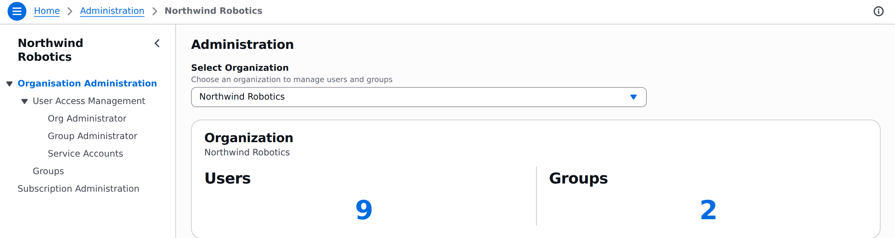

.. _admin-index:

Organisation Administration
===========================

If you are an administrator for your organisation, the **Administration**
area of the Linaro Solutions Hub lets you manage the people in your
organisation, the seats they hold, your groups and your service accounts.

You will only see **Administration** in your user menu if you hold an
**Organization Admin**, **Group Administrator** or **Subscription
Administrator** seat. If you think you should have one of these, ask an
existing administrator in your organisation.

To open Organisation Administration:

1. Click on your name in the top-right of the page and then click on
   **Administration**:

   .. image:: admin-1.png
       :scale: 50 %
       :alt: User menu with Administration highlighted

2. Under **Organisation Administration**, click on **Select Organisation**:

   .. image:: admin-2.png
       :scale: 50 %
       :alt: Administration page with the Select Organisation list highlighted

3. Click on the organisation you want to manage:

   .. image:: admin-3.png
       :scale: 50 %
       :alt: Organisation list open with an organisation highlighted

   If you only administer one organisation and you do not also administer
   any subscriptions, you are taken straight to it and can skip this step.

The overview page shows how many users and groups your organisation has.
Click on a number to go to that list. The menu on the left takes you to each
part of Organisation Administration:

To manage the subscriptions your organisation uses, see
:doc:`/submgmt/index`.

.. toctree::
    :maxdepth: 3

    users
    org-administrators
    group-administrators
    service-accounts
    groups
