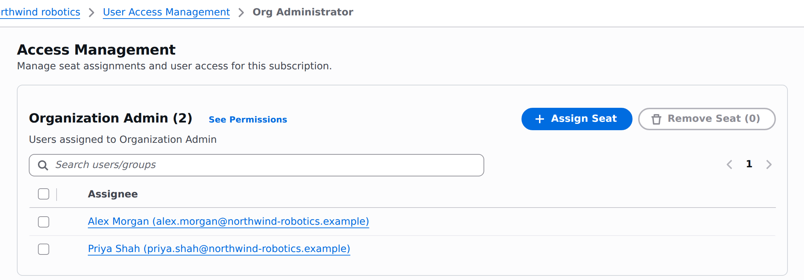

.. _admin-org-administrators:

Organisation Seats
==================

The **Org Administrator** page lists who holds each of your organisation's
seats: **Organization Admin** and **PAT User**. It is the quickest way to
see, for example, everyone who can create personal access tokens, and to
remove seats.

Open :doc:`Organisation Administration <index>` and click on **Org
Administrator** in the menu on the left, under **User Access Management**:

Each seat type has its own list. Click on **See Permissions** next to a seat
type to see what the seat allows, and click on a person's name to change the
permissions their seat includes.

To give someone a seat, click on **Assign Seat** next to the seat type and
follow the steps in :doc:`users`.

Removing a seat
---------------

1. In the list for the seat type, tick the box next to each person whose
   seat you want to remove, then click on **Remove Seat**. The button shows
   how many seats you have selected:

   .. image:: orgadmin-2.png
       :scale: 50 %
       :alt: PAT User seat list with one person selected and the Remove Seat button highlighted

2. Check the list of people, then click on **Yes, Remove**:

   .. image:: orgadmin-3.png
       :scale: 50 %
       :alt: Confirm Seat Removal dialog with the Yes, Remove button highlighted

The people lose the access the seat gave them straight away.

.. warning:: Make sure your organisation always has at least one person with
   an **Organization Admin** seat. If you remove your own seat, you will no
   longer be able to manage your organisation.
