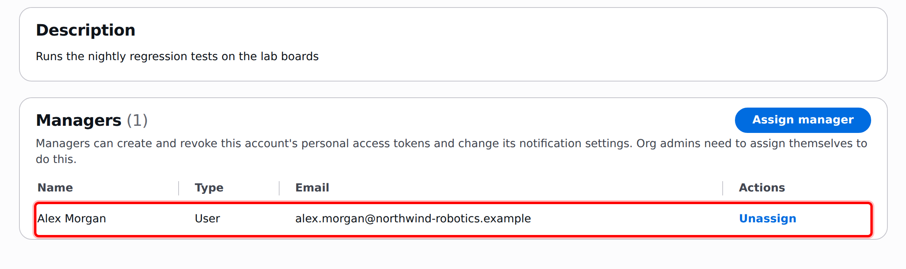

.. _admin-service-accounts:

Service Accounts
================

A service account is a non-human account in your organisation, for example
for a CI system or a script that needs to call the Linaro Solutions Hub API.
A service account cannot sign in. Instead, the people you make its
**managers** create personal access tokens for it.

Open :doc:`Organisation Administration <index>` and click on **Service
Accounts** in the menu on the left, under **User Access Management**.

Creating a service account
--------------------------

1. Click on **Create service account**:

   .. image:: sa-1.png
       :scale: 50 %
       :alt: Service accounts list with the Create service account button highlighted

2. Enter a **Display name** and, optionally, a **Description** of what the
   account is for and who owns it, then click on **Create service
   account**:

   .. image:: sa-2.png
       :scale: 50 %
       :alt: Create service account form with the Create service account button highlighted

   * **First name** and **Last name** are optional.

   * Leave **Email address** empty unless the account should receive
     notification emails. If you leave it empty, an address that cannot
     receive mail is generated for the account.

   .. warning:: Anyone who can see the service account can read its
      description. Never put a token, password or other secret in it.

The service account's page opens.

Choosing who manages a service account
--------------------------------------

Only the managers of a service account can create and revoke its personal
access tokens. Being an Organization Admin is not enough on its own: you
must assign yourself if you want to manage the account.

On the service account's page, in the **Managers** section:

* Click on **Assign to me** to make yourself a manager:

  .. image:: sa-3.png
      :scale: 50 %
      :alt: Service account page with the Assign to me button highlighted

* Click on **Assign manager** to choose another person, or a group, from
  your organisation. If you choose a group, every member of the group
  becomes a manager.

The managers are listed in the **Managers** section. Click on **Unassign**
to remove a manager:

Managers then create the service account's access tokens on their
:doc:`Managed Accounts </settings/managed-accounts>` page. They can also use
the :doc:`SPIRE CLI </cli/service-account>`.

Changing or deleting a service account
--------------------------------------

Click on the service account's name in the list to open its page. Click on
**Edit** to change its details, for example to give it a real email address
so that it can receive notification emails.

To delete a service account:

1. On its page, click on **Delete**:

   .. image:: sa-5.png
       :scale: 50 %
       :alt: Service account page with the Delete button highlighted

2. Check the account's email address, then click on **Delete**:

   .. image:: sa-6.png
       :scale: 50 %
       :alt: Delete service account confirmation dialog with the Delete button highlighted

.. warning:: Deleting a service account also deletes its personal access
   tokens and ends its sessions straight away. Anything that uses the account
   stops working, and this cannot be undone.
