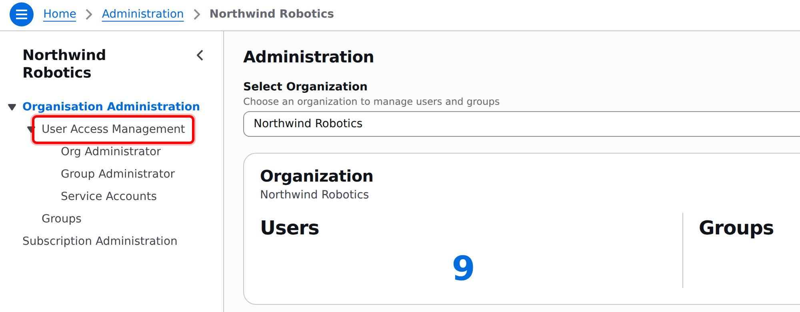
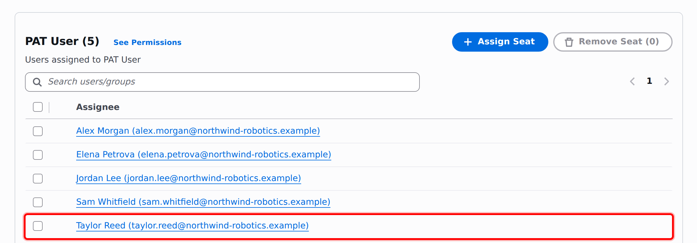

.. _admin-users:

Users
=====

The **User Access Management** page lists everyone in your organisation and
the organisation seats they hold. From here you can add people to your
organisation, give them seats and remove them.

Open :doc:`Organisation Administration <index>` and click on **User Access
Management** in the menu on the left:

The **PAT Seat**, **Org Administrator** and **Group Administrator** columns
show which organisation seats each person holds:

* **PAT User**: the person can create :doc:`personal access tokens
  </settings/access-tokens>`.

* **Organization Admin**: the person can manage your organisation's users,
  seats, groups and service accounts.

* **Group Administrator**: the person can create and manage groups.

Adding a person and giving them a seat
--------------------------------------

People are added to your organisation by giving them a seat. If the person
does not have a Linaro Solutions Hub account yet, you can create one as part
of the same steps.

1. Click on **Assign Seat**:

   .. image:: users-2.png
       :scale: 50 %
       :alt: User Access Management page with the Assign Seat button highlighted

2. Click on **Seat Type** and choose the seat you want to give:

   .. image:: users-3.png
       :scale: 50 %
       :alt: Seat Type list with the PAT User seat highlighted

3. In **Search Users**, enter the person's name or email address. If they
   are listed, tick the box next to their name and go to step 6.

4. If the person cannot be found, enter their full email address and click
   on **Create User**:

   .. image:: users-4.png
       :scale: 50 %
       :alt: Assign Seats page showing no users found and the Create User button highlighted

5. Enter the person's **First Name** and **Surname**, check the **Email
   Address**, and click on **Create User**:

   .. image:: users-5.png
       :scale: 50 %
       :alt: Create User dialog with the Create User button highlighted

   The new person is selected for you. Their first name and surname must
   each be at least two characters long.

6. Click on **Assign 1 User(s)**. The button shows how many people you have
   selected:

   .. image:: users-6.png
       :scale: 50 %
       :alt: Assign Seats page with a user selected and the Assign button highlighted

The **Org Administrator** page opens and the person is listed under the seat
you gave them:

.. note:: Creating an account does not send the person an email. Let them
   know that they should now sign up to the Linaro Solutions Hub using that
   email address; see :doc:`/using/signup`. They are added to your
   organisation automatically when they do.

To give a seat to everyone in a group at once, click on the **Groups** tab
in step 3 instead of searching for users.

Changing a person's seats and details
-------------------------------------

1. Tick the box at the start of the person's row.

2. Click on **Actions** and choose what you want to do:

   .. image:: users-8.png
       :scale: 50 %
       :alt: Actions menu open for a selected user

   * **Grant** or **Remove** a PAT, Organization Admin or Group
     Administrator seat. Options that do not apply to the selected person
     are greyed out.

   * **Edit permissions** changes exactly which permissions one of the
     person's seats includes.

   * **Edit email address** changes the email address the person signs in
     with.

   * **Update state** changes whether the person's account is active.

   * **Remove user** removes the person from your organisation.

You can select more than one person to grant or remove a seat for all of
them at once.

Removing a person
-----------------

1. Tick the box at the start of the person's row, click on **Actions** and
   then click on **Remove user**.

2. Check the name and email address, then click on **Remove**:

   .. image:: users-9.png
       :scale: 50 %
       :alt: Remove user confirmation dialog with the Remove button highlighted

The person's account is made inactive, so they can no longer sign in. They
may still be listed on this page and keep any seats they held, so remove
their seats as well; see :doc:`org-administrators`.
