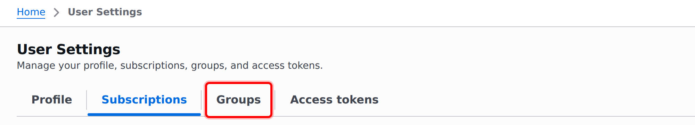
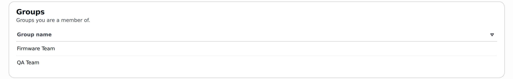

.. _settings-groups:

Groups
======

The **Groups** tab of :doc:`User Settings <index>` lists the groups
you are a member of. Your organisation uses groups to give the same access to
several people at once: any seat assigned to a group applies to everyone in
it.

To see your groups, click on the **Groups** tab:

The tab lists the name of each group you belong to:

You cannot join or leave a group yourself. If you need to be added to or
removed from a group, ask your organisation administrator.
