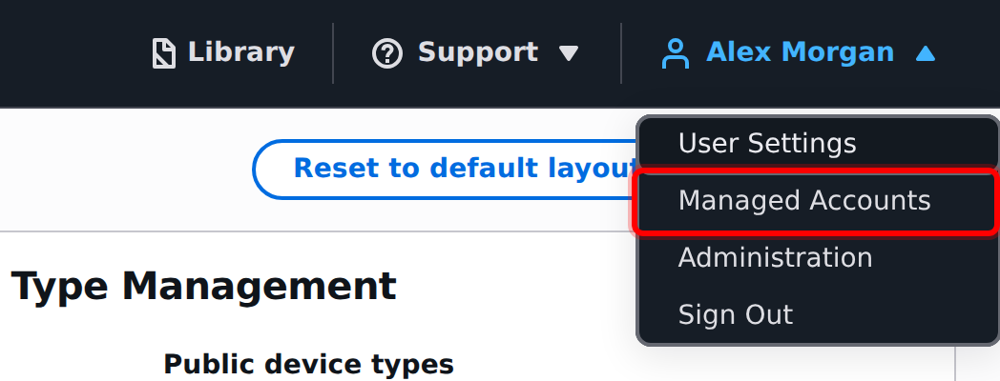

.. _settings-managed-accounts:

Managed Accounts
================

If you have been made a manager of a service account, or you manage an M2M
(machine-to-machine) account, the **Managed Accounts** page is where you
create and delete that account's access tokens. A service account cannot
sign in itself, so its managers look after its tokens for it.

You will only see **Managed Accounts** in your user menu if you manage at
least one account. Organisation administrators choose who manages each
service account; see :doc:`/admin/service-accounts`.

To open the page, click on your name in the top-right of the page and then
click on **Managed Accounts**:

Each account you manage has its own panel, showing its details, its access
tokens and, where available, its notification settings.

The **Email address (PAT username)** shown in the panel is the username to
use with the account's access tokens.

Creating an access token for an account
---------------------------------------

1. In the account's panel, click on **Create access token**:

   .. image:: managed-2.png
       :scale: 50 %
       :alt: Managed accounts page with the Create access token button for a service account highlighted

2. Fill in the form in the same way as for your own tokens (see
   :doc:`access-tokens`), then click on **Create token**:

   .. image:: managed-3.png
       :scale: 50 %
       :alt: Create access token dialog for a service account with the Create token button highlighted

   A token for the account can only do what the account itself is allowed
   to do. Leave **Subscription** and **Service** empty for a token with all
   of the account's permissions.

3. Click on the copy icon next to the token and store it somewhere safe,
   such as the secret store of the system that will use it:

   .. image:: managed-4.png
       :scale: 50 %
       :alt: Access token created dialog with the copy icon highlighted

   .. warning:: This is the only time the token is shown. It cannot be
      retrieved after you close the dialog.

4. Click on **I've saved the token**.

Deleting an account's access token
----------------------------------

1. In the account's **Access tokens** list, click on the bin icon at the end
   of the token's row:

   .. image:: managed-5.png
       :scale: 50 %
       :alt: Access token list for a service account with the delete icon highlighted

2. Click on **Delete** to confirm.

Anything using the token stops working, and sessions obtained with it are
revoked shortly afterwards. The account's other tokens are not affected.

Notification settings
---------------------

If an account has a real email address, its panel also has a
**Notification settings** section:

* **Email**: also send the account's notifications to its email address.

* **Auto-archive after (days)**: archive the account's notifications once
  they are older than this, from 1 to 90 days. Leave it empty to use the
  default of 30 days.

Accounts with a generated address, shown as **(generated, no mailbox)**,
cannot receive email, so this section is not shown for them. An
organisation administrator can give a service account a real mailbox by
editing it.
