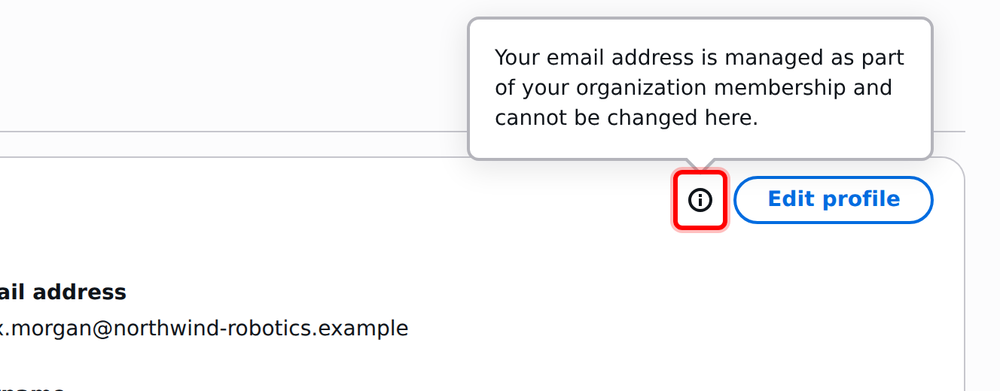

.. _settings-profile:

Profile
=======

The **Profile** tab of :doc:`User Settings <index>` shows the details
of your account: your display name, email address, first name and surname,
and the organisation you belong to, if any. From here you can also change
your name, email address and password.

What you can change depends on how you sign in. If you sign in through your
organisation's single sign-on (SSO), your details are managed by your
organisation and most of the options on this page are not available.

Changing your name
------------------

1. On the **Profile** tab, click on **Edit profile**:

   .. image:: profile-1.png
       :scale: 50 %
       :alt: Profile tab with the Edit profile button highlighted

2. Change your **Display name**, **First name** or **Surname**, then click on
   **Save changes**:

   .. image:: profile-2.png
       :scale: 50 %
       :alt: Profile edit form with the Save changes button highlighted

   All three fields are required. Your first name and surname must each be at
   least two characters long. Names can contain letters, spaces, hyphens and
   apostrophes.

.. note:: If **Edit profile** is greyed out, you signed in with SSO. Your
   organisation manages your name, so ask your organisation administrator if
   it needs to change.

Changing your email address
---------------------------

If you are a member of an organisation, your email address is managed as
part of your organisation membership and cannot be changed on this page.
Click on the information icon next to **Edit profile** to see why:

Ask your organisation administrator if your email address needs to change.

If you are not a member of an organisation and you sign in with an email
address and password, the **Profile** tab has an **Email address** section:

1. Click on **Change email address**.

2. Enter your new email address and click on **Send verification code**.

3. Find the email sent to your new address, enter the code it contains and
   click on **Confirm email change**.

You are then signed out. Sign in again with your new email address.

.. note:: An email is also sent to your previous address with a link to undo
   the change. The link works for 72 hours, and you cannot change your email
   address again during that time.

Changing your password
----------------------

If you sign in with an email address and password, you change your password
by asking for a password reset email.

1. In the **Password** section, click on **Send password reset email**:

   .. image:: profile-4.png
       :scale: 50 %
       :alt: Password section with the Send password reset email button highlighted

2. Open the email and click on the link to choose a new password.

You will need to sign in again afterwards. If the email does not arrive,
click on **Resend password reset email**.

Refreshing your session token
-----------------------------

.. warning:: Only refresh your session token if the Support team asks you to.
   It is not needed for normal use.

If the Support team asks you to refresh your session token, for example
after your permissions have changed:

1. In the **Session token** section, click on **Refresh token**:

   .. image:: profile-5.png
       :scale: 50 %
       :alt: Session token section with the Refresh token button highlighted

2. Click on **Refresh token** to confirm:

   .. image:: profile-6.png
       :scale: 50 %
       :alt: Refresh session token confirmation dialog with the Refresh token button highlighted
