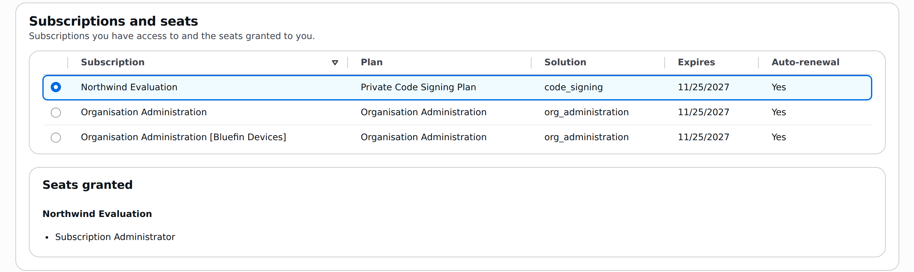

.. _settings-subscriptions:

Subscriptions
=============

The **Subscriptions** tab of :doc:`User Settings <index>` lists the
subscriptions you have access to and the seats you have been given in each
one. A seat is what gives you permission to use a product or feature; see the
:doc:`glossary </glossary/index>` for more about subscriptions and seats.

Seeing your seats in a subscription
-----------------------------------

1. Click on the **Subscriptions** tab:

   .. image:: subscriptions-1.png
       :scale: 50 %
       :alt: User Settings page with the Subscriptions tab highlighted

2. Click on the round selection button at the start of a subscription's
   row:

   .. image:: subscriptions-2.png
       :scale: 50 %
       :alt: Subscriptions table with the selection button for a subscription highlighted

The **Seats granted** panel below the table lists the seats you hold in that
subscription:

What the table shows
--------------------

* **Subscription**: the name of the subscription. If the subscription belongs
  to a different organisation from your own, that organisation's name is
  shown after it in square brackets.

* **Plan** and **Solution**: what the subscription is for.

* **Expires**: the date the subscription ends.

* **Auto-renewal**: whether the subscription renews automatically when it
  expires.

If a subscription you expect to see is missing, or you need a different
seat, ask the administrator of that subscription.
