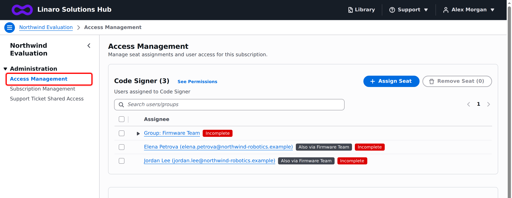

.. _submgmt-access-management:

Access Management
=================

The **Access Management** page shows each seat type on the subscription and
who has been given a seat of that type. It opens when you choose a
subscription in :doc:`Subscription Administration <index>`. To return to it
from another page, click on **Access Management** in the menu on the left:

Each seat type has its own table. Groups appear as rows you can expand to see
their members. Click on **See Permissions** next to a seat type to open a
panel listing the permissions that come with it. Some people show badges;
see :ref:`What the badges mean <submgmt-badges>`.

Assigning a seat
----------------

1. Click on **Assign Seat** on the seat type you want to give out:

   .. image:: access-mgmt-2.png
       :scale: 50 %
       :alt: Subscription Administrator table with the Assign Seat button highlighted

2. Check that the correct **Seat Type** is selected. To assign the seat to
   a group, click on the **Groups** tab.

3. If the seat type's permissions apply to a specific resource, choose the
   resource under the permission name. If the form says **No resources
   available for this subscription**, the seat can't be fully assigned yet;
   the person gets the seat but will show as **Incomplete** until a resource
   exists and the permission is added.

4. Type part of a name or email address in **Search Users**, tick each
   person who should have the seat, then click on **Assign** *n*
   **User(s)**:

   .. image:: access-mgmt-3.png
       :scale: 50 %
       :alt: Assign Seats form with a user ticked and the Assign 1 User(s) button highlighted

   On the **Groups** tab, tick each group under **Available Groups** and
   then click on **Assign** *n* **Group(s)**.

The seat is given with all of the permissions that come with its seat type,
except any that need a resource you haven't chosen.

Changing the permissions in a seat
----------------------------------

1. In the seat type's table, click on the person whose seat you want to
   change:

   .. image:: access-mgmt-4.png
       :scale: 50 %
       :alt: Subscription Administrator table with a user's name highlighted

   The **Edit Permissions** page lists every permission the seat type offers.
   Permissions the person has are **Assigned**; ones they don't have are
   **Available**.

2. To remove permissions, tick them and then click on **Delete Permissions**
   *(n)*:

   .. image:: access-mgmt-5.png
       :scale: 50 %
       :alt: Edit Permissions page with one permission ticked and the Delete Permissions (1) button highlighted

   The permissions are removed straight away.

3. To add permissions, click on the **+** button at the start of each
   **Available** permission you want to add:

   .. image:: access-mgmt-6.png
       :scale: 50 %
       :alt: Edit Permissions page with the add button on an Available permission highlighted

   Then click on **Add Permissions** *(n)*:

   .. image:: access-mgmt-7.png
       :scale: 50 %
       :alt: Edit Permissions page with the Add Permissions (1) button highlighted

   If a permission can target either the whole subscription or a specific
   resource, choose the **Target Type**, and a **Target Name** if needed,
   before you add it.

   To change what an assigned permission applies to, click on the pencil in
   its **Target Type** column, choose the new target, then click on **Save
   Changes**.

You can't add and delete permissions in the same step. Click on **Undo** to
clear your unsaved selections, or **Cancel** to go back to the Access
Management page.

Removing a seat
---------------

1. In the seat type's table, tick each person or group whose seat you want to
   remove, then click on **Remove Seat** *(n)*:

   .. image:: access-mgmt-8.png
       :scale: 50 %
       :alt: Subscription Administrator table with a user ticked and the Remove Seat (1) button highlighted

2. Check the names in the **Confirm Seat Removal** dialog, then click on
   **Yes, Remove**:

   .. image:: access-mgmt-9.png
       :scale: 50 %
       :alt: Confirm Seat Removal dialog with the Yes, Remove button highlighted

.. warning::

   Removing a seat takes away all of its permissions straight away and can't
   be undone. To give the person access again, assign them a new seat.

.. note::

   Removing a group's seat removes it from everyone who had it through that
   group.

.. _submgmt-badges:

What the badges mean
--------------------

* **Also via** *group name*: the person has this seat both directly and
  through a group.
* **Incomplete**: the person's seat does not have every permission the seat
  type offers. This is expected if some permissions have been removed on
  purpose, or if they can only target a specific resource and none has been
  chosen yet.
