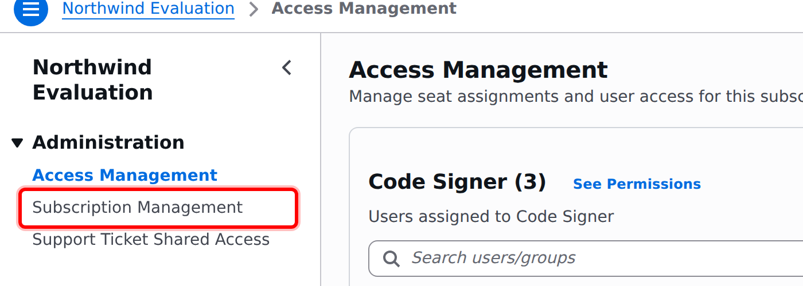
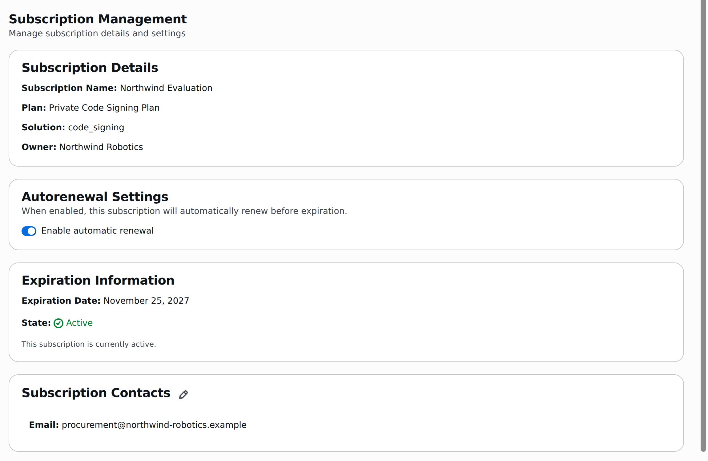

.. _submgmt-subscription-management:

Subscription Management
=======================

The **Subscription Management** page shows a subscription's details and lets
you change whether it renews automatically and who its contacts are.

To open it, choose the subscription in :doc:`Subscription Administration
<index>`, then click on **Subscription Management** in the menu on the left:

The page shows the subscription's name, plan, solution and owning
organisation, its expiration date and its current state:

Changes you make on this page are not saved until you click on **Save
Changes**. Click on **Cancel Changes** to discard them.

Turning automatic renewal on or off
-----------------------------------

1. Click on the **Enable automatic renewal** switch:

   .. image:: sub-mgmt-3.png
       :scale: 50 %
       :alt: Autorenewal Settings with the Enable automatic renewal switch highlighted

2. Click on **Save Changes** at the bottom of the page.

When automatic renewal is on, the subscription renews before its expiration
date.

Changing the subscription contacts
----------------------------------

Subscription contacts are the email addresses of the people to contact about
the subscription.

1. Click on the pencil button next to **Subscription Contacts**:

   .. image:: sub-mgmt-4.png
       :scale: 50 %
       :alt: Subscription Contacts with the edit button highlighted

2. Change the addresses:

   * edit an address in its **Email Address** box
   * click on **Add another email** to add an address
   * click on **Remove** next to an address to remove it

3. Click on **Save Changes**:

   .. image:: sub-mgmt-5.png
       :scale: 50 %
       :alt: Subscription Contacts being edited with the Save Changes button highlighted

.. note::

   You need permission to update the subscription to change these settings.
   If you can't see **Save Changes** after making a change, ask another
   subscription administrator.
