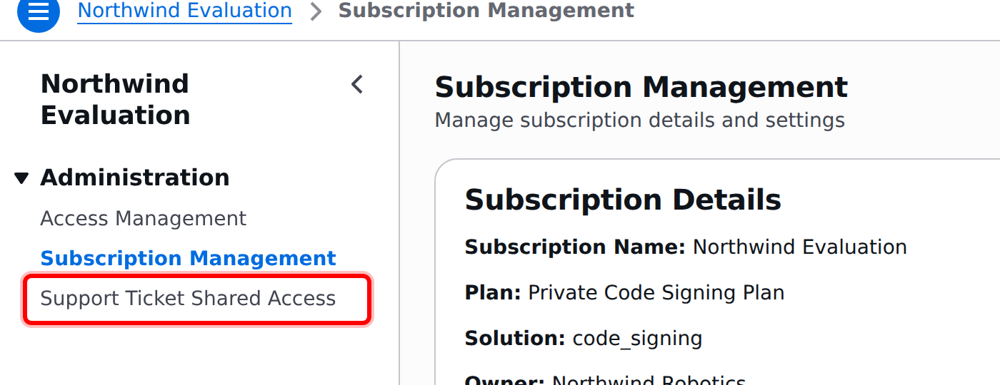
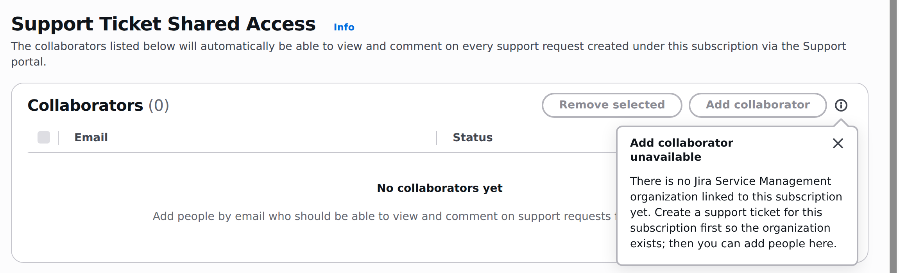
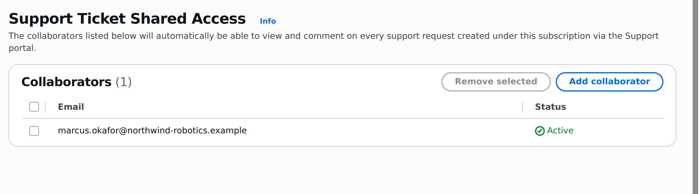

.. _submgmt-support-shared-access:

Support Ticket Shared Access
============================

The **Support Ticket Shared Access** page lets you add *collaborators*: people
who can view and comment on every support ticket raised under the
subscription, through the Support portal.

To open it, choose the subscription in :doc:`Subscription Administration
<index>`, then click on **Support Ticket Shared Access** in the menu on the
left:

The **Collaborators** table lists each collaborator's **Email** and whether
their account is **Active** or **Inactive**.

Before the first support ticket
-------------------------------

**Add collaborator** is unavailable until someone has raised a support ticket
for the subscription. Click on the information button next to it to see why:

To make it available, raise a ticket for the subscription; see
:doc:`/support/asking`.

Adding collaborators
--------------------

1. Click on **Add collaborator**:

   .. image:: shared-access-3.png
       :scale: 50 %
       :alt: Support Ticket Shared Access page with the Add collaborator button highlighted

2. Type part of a name or email address in **Search users**. You can search
   for people in any organisation.

3. Under **Available users**, tick each person you want to add. Your
   selections are kept if you change the search, so you can add several
   people at once.

4. Click on **Add 1 collaborator** (or **Add** *n* **collaborators**):

   .. image:: shared-access-4.png
       :scale: 50 %
       :alt: Add collaborator page with a user ticked and the Add 1 collaborator button highlighted

You return to **Support Ticket Shared Access**, where the people you added
are listed:

If someone is already a collaborator, the Add collaborator page shows
**Already a member** and nothing changes.

Removing collaborators
----------------------

1. In the **Collaborators** table, tick each person you want to remove, then
   click on **Remove selected** *(n)*:

   .. image:: shared-access-6.png
       :scale: 50 %
       :alt: Collaborators table with one collaborator ticked and the Remove selected (1) button highlighted

2. Check the email addresses in the dialog, then click on **Remove**:

   .. image:: shared-access-7.png
       :scale: 50 %
       :alt: Remove collaborator dialog with the Remove button highlighted

Removed collaborators may lose access to the subscription's support tickets.
