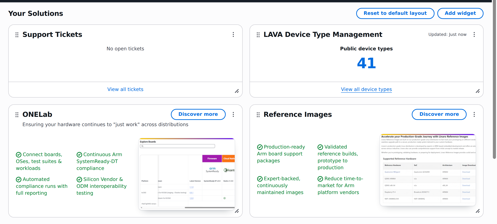
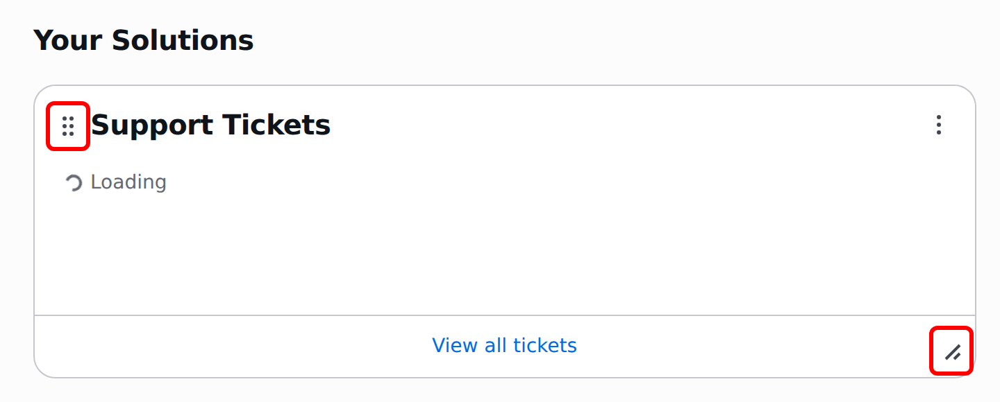
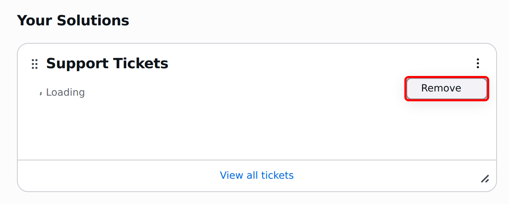
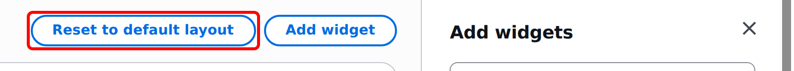

.. _using-home:

Your Home Dashboard
===================

When you are signed in, the home page shows **Your Solutions**: a dashboard
of widgets for the solutions and services available to you, such as your
open support tickets:

You can arrange the widgets to suit you. Your layout is saved in your web
browser, so it applies on this computer and browser only.

Moving and resizing a widget
----------------------------

* To move a widget, drag it by the handle in its top-left corner.
* To resize it, drag the handle in its bottom-right corner:

You can also use the keyboard: select a handle, press **Space** or **Enter**,
use the arrow keys, then press **Space** or **Enter** again to finish, or
**Escape** to cancel.

Removing a widget
-----------------

Click on the **⋮** button at the top-right of the widget and then click on
**Remove**:

The widget is removed straight away. You can add it back at any time.

Adding a widget
---------------

1. Click on **Add widget**:

   .. image:: home-4.png
       :scale: 50 %
       :alt: Your Solutions header with the Add widget button highlighted

2. In the **Add widgets** panel, drag a widget by its handle onto the
   dashboard:

   .. image:: home-5.png
       :scale: 50 %
       :alt: Add widgets panel with a widget's drag handle highlighted

   The panel only lists widgets that aren't already on your dashboard.

Going back to the default layout
--------------------------------

Click on **Reset to default layout**:

This puts back every widget in its original position and size.
