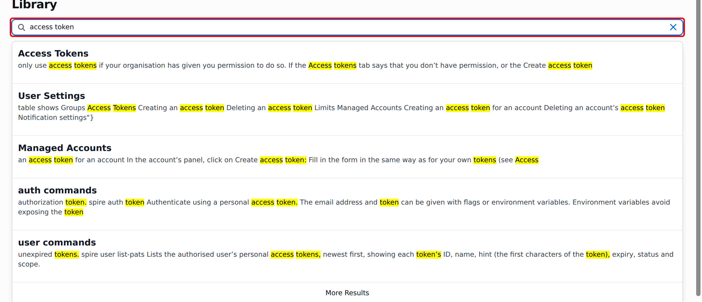

.. _using-library:

The Library
===========

The **Library** holds the documentation for the Linaro Solutions Hub and its
solutions, including this guide. You don't need to be signed in to read it.

1. Click on **Library** on the top navigation bar:

   .. image:: library-1.png
       :scale: 50 %
       :alt: Top navigation bar with Library highlighted

2. Click on the documentation you want to read:

   .. image:: library-2.png
       :scale: 50 %
       :alt: Library page with the Linaro Solutions Hub documentation highlighted

   Use the menu on the left of each page to move around that documentation.

Searching the Library
---------------------

Type in **Search all documentation** at the top of the Library page. The
results update as you type and cover every set of documentation in the
Library. Click on a result to open that page:

Click on the **×** in the search box to clear it.
