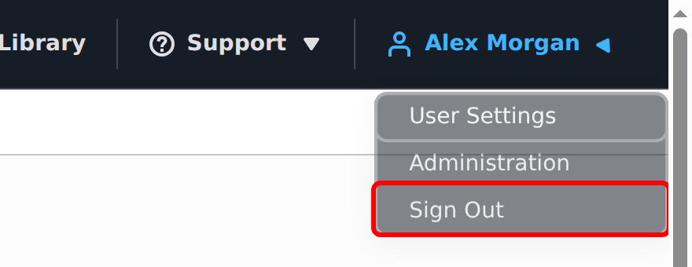

.. _using-signin:

Signing In
==========

1. Click on **Sign In / Sign Up** in the top-right of the page:

   .. image:: signin-1.png
       :scale: 50 %
       :alt: Top navigation bar with Sign In / Sign Up highlighted

2. Choose how to sign in:

   * If you have a Linaro Solutions Hub account, or your organisation has an
     arrangement with Linaro to use its own sign-in system, enter your email
     address and click on **Continue**:

     .. image:: signin-2.png
         :scale: 50 %
         :alt: Welcome screen with an email address entered and the Continue button highlighted

   * If you have a Google account, click on **Continue with Google**.
   * If you have set up a passkey, click on **Continue with a passkey**.
   * If you don't have an account yet, click on **Sign up**; see
     :doc:`signup`.

   If your organisation uses its own sign-in system, you are taken there.
   Sign in as usual and you will be returned to the Linaro Solutions Hub.

3. Enter your password and click on **Continue**:

   .. image:: signin-3.png
       :scale: 50 %
       :alt: Enter Your Password screen

   To use a different email address, click on **Edit**.

Some of these steps may not appear if you have signed in recently.

If you have forgotten your password
-----------------------------------

1. On the password screen, click on **Reset password**:

   .. image:: signin-4.png
       :scale: 50 %
       :alt: Enter Your Password screen with Reset password highlighted

   You can also click on **Can't log in to your account?** on the first
   screen.

2. Check your email address and click on **Continue**:

   .. image:: signin-5.png
       :scale: 50 %
       :alt: Forgot Your Password screen

3. Follow the link in the email you receive to choose a new password.

.. note::

   You only receive an email if the address matches an account. If you still
   can't sign in, see :doc:`/support/asking`.

Signing out
-----------

Click on your name in the top-right of the page and then click on **Sign
Out**:

