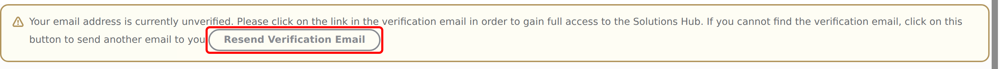

.. _using-signup:

Signing Up for a New Account
============================

1. Click on **Sign In / Sign Up** in the top-right of the page, then click on
   **Sign up**:

   .. image:: signup-1.png
       :scale: 50 %
       :alt: Welcome screen with the Sign up link highlighted

2. Choose how to sign up:

   * To use a Google account, click on **Continue with Google**.
   * If you already have an account, or your organisation has an arrangement
     with Linaro to use its own sign-in system, click on **Log in** instead;
     see :doc:`signin`.
   * Otherwise, enter the email address you want to use and click on
     **Continue**:

     .. image:: signup-2.png
         :scale: 50 %
         :alt: Create Your Account screen

3. Choose a password and click on **Continue**. The screen lists the rules
   your password must meet:

   .. image:: signup-3.png
       :scale: 50 %
       :alt: Create Your Account screen with a password entered and the Continue button highlighted

4. Enter your **Given name** and **Family name** and click on **Continue**:

   .. image:: signup-4.png
       :scale: 50 %
       :alt: Please provide additional information form with the Continue button highlighted

.. note::

   You will receive an email asking you to verify your email address. It is
   **strongly** recommended that you click on the link in that email before
   you finish signing up.

If you haven't verified your email address
------------------------------------------

Until you verify your email address, your home page shows only this message
and you won't have full access:

To finish setting up your account:

1. Find the verification email and click on the link in it. If you can't
   find it, click on **Resend Verification Email**.

2. Click on your name in the top-right of the page and then click on **Sign
   Out**.

3. :doc:`Sign in <signin>` again.
